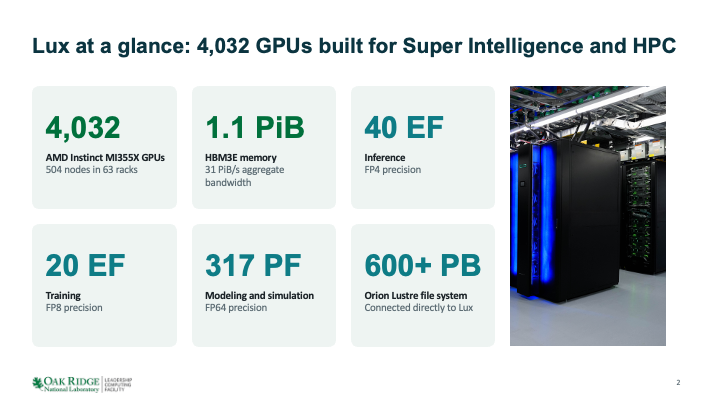
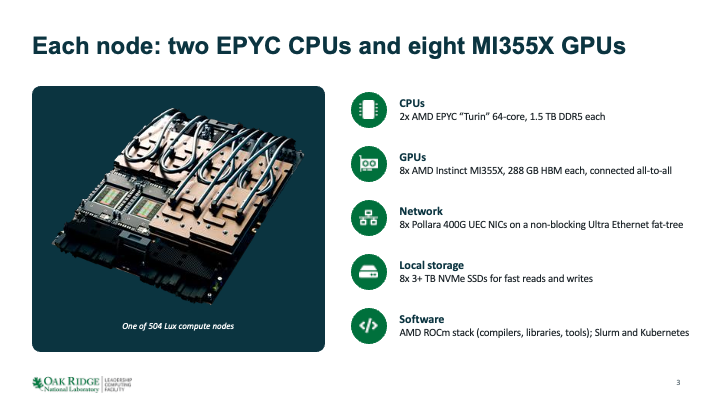

# Welcome to Hands-on New User training (Tony)
 
This training is designed to introduce you to the Oak Ridge Leadership Computing Facility and its resources. 
You should never be more than 20 minutes away from and hands-on exercise. 
For this training you will want to have a browser window open and an ssh terminal open.
Attendees interested in access to Lux who do not yet have access are encouraged follow along with examples and learn about what Lux has to offer, and an overview of how it works.

 
## Resources Overview (Tony)
 
We'll begin with an overview of Lux, our AMD-based supercomputer built on HPE ProLiant XD685 nodes.
 
Since it is easiest to do this from pictures, lets go to the Lux docs:
https://docs.olcf.ornl.gov/systems/lux_user_guide.html#system-overview

<br/>
<div style="text-align: center">

</div>
<br/>
<br/>
<div style="text-align: center">

</div>

## Getting a project

Lux allocations are distributed by means of [Genesis Mission](https://www.energy.gov/undersecretaryforscience/genesis-mission/genesis-mission) RFA projects, Director's Discretion, or AMD partners.

Each year, about half of Lux's time is allocated by DOE programs.

### Getting access to Lux

* RFA Team PI's can request access to Lux on the Genesis Mission Consortium page through RTI: https://partnerships.genesismissionconsortium.org/user/login
* Project proposals are welcome at OLCF under a Director's Discretion application: https://docs.olcf.ornl.gov/accounts/accounts_and_projects.html#what-are-the-differences-between-project-types
* AMD allows partners to access the public & private partnership allocation. If you are interested please see https://www.olcf.ornl.gov/olcf-resources/compute-systems/lux/ and reach out to OLCFpartner@ornl.gov

## Projects and accounts

### Projects

Projects, not users, are associated with Lux.
Projects have associated machines, allocations, and services.

### Accounts

User accounts are associated with projects.

## Login (Tony)
### Hands-on Finding Jupyter terminal (Tony)
If you do not have an ssh terminal:
1. Open and tab on your browser and direct it to https://docs.olcf.ornl.gov/services_and_applications/jupyter/overview.html#access.
2. Then follow the directions there to access the moderate JupyterHub if you are a Lux user and choose one of the CPU labs.
3. Once you are in, find the "terminal icon". Now you will be ready to do the first hands-on.
 
There are many more uses for OLCF Jupyter Hub and you can find them in the Jupyter at OLCF guide. https://docs.olcf.ornl.gov/services_and_applications/jupyter/overview.html
 
### How to login to Lux (Tony)
 
Once you have a terminal open (either through Jupyter or by opening a terminal program on your computer).
You can login to Lux by executing the following command
 
```
$ ssh <your username>@lux.olcf.ornl.gov
```
 
Replace `<your username>` with your actual username.

 
After you press enter, you will be asked to enter your PASSCODE
 
```
$ ssh <your username>@lux.olcf.ornl.gov
Enter PASSCODE:
```
 
Type in your PIN followed by the six digits shown on your RSA token in one continuous sequence (no spaces). 
You will not see anything being typed on screen, THIS IS NORMAL. 
SSH does give you any visual feedback when typing your PASSCODE, but it is still receiving your key presses. 
Just type the full PASSCODE on your keyboard normally and press enter.
 
If this is your first time ever logging in and you've not set your PIN before, follow the steps in [Activating a New SecurID Fob in the docs](https://docs.olcf.ornl.gov/connecting/index.html#activating-a-new-securid-fob).
 
If your SSH operation succeeds, you should be placed in your home directory on Lux
 
```
[subil@login1.lux ~]$ pwd
/ccs/home/subil
```

### Clone the NewUserQuickStart repository

Parts of this new user training will have hands on portions. 
So clone this repository into your home directory with

```
git clone https://github.com/olcf/NewUserQuickStart
```

And navigate to the Lux directory
```
cd NewUserQuickStart
cd Lux
```
 
### Authentication with RSA tokens (Tony)
 
In an earlier section, we covered logging into Lux using SSH and with your RSA token. 
Let's talk a bit more about what we're doing here.
 
We are using 2-factor authentication via user-selected PINs and RSA securID token. 
The numbers on the RSA securID token change every 30 seconds. 
Entering your PIN+tokencode is the only login method available. 
Using other methods (password, public key, etc) are not allowed.
 
#### RSA terminology
* tokencode - the 6 digit number on your RSA token
* PIN - an alphanumeric string of 4-8 characters known only to you
* PASSCODE - your PIN followed by the current tokencode without any spaces
 
#### Common Login Issues
 
SSH will not prompt you for your username, so make sure that when you SSH you are using the full `ssh <your username>@lux.olcf.ornl.gov`.
 
Your RSA token might get out of sync with the server. So sometimes you might be prompted for 'next tokencode'
```
Enter PASSCODE:
Wait for the tokencode to change, then enter the new tokencode :
```
When this happens, enter only the tokencode your RSA token generates. 
Don't enter the PIN. 
In general, when it asks for PASSCODE, enter the PIN+tokencode. 
For any other case, the terminal will explicitly tell you what it wants you to do.
 
Sometimes you might encounter a message that looks like "Connection closed by <ip address>" after you correctly enter your PASSCODE. 
This usually indicates that your account no longer has access to the particular system you are trying to SSH to. 
Your account's access to systems is tied to your project. 
So when your project's access to a system expires, you lose access to that system.
 
 
If your PASSCODE has failed twice i.e. you are being prompted to enter your PASSCODE for the third time in a row, let the tokencode change before you try entering your PASSCODE again (to avoid getting locked out).
 
If you find that you keep entering the PASSCODE correctly but it fails to log you in, its possible you may have been locked out. 
Send an email to help@olcf.ornl.gov with the information on what you are seeing. 
If your account is locked, the OLCF Help Desk can unlock it for you.

 
## User Guides Overview
OLCF has users guides for its compute systems, data management tools and polices. 
They have examples that cover the basics that you need to know to run on our system. 
Let's start with a hands-on to help you find and navigate those guides.

### OLCF User Guide Hands On
Open a browser tab and go to https://docs.olcf.ornl.gov.
Select the "Systems" option in the left menu bar.

1.	Open Riker guide: Raise your virtual hand when it is open.

2.	Name one visualization tool available on Riker.

3.	What Riker batch queue has the longest available run time?

Close the Riker system guide on the left and open the Lux user guide.
Raise your virtual hand when it is open.

1.	Name one profiling application available on Lux that is described in the guide.

2.	Find the Thread Mapping examples in the running jobs section; What is the `srun` command that ensures that the MPI tasks will be distributed across sockets in a cyclic (round-robin) manner?

3.	Find the Tips and Tricks section; Read the name of one tip listed in that section.

4.  Find the Containers section; What is the primary runtime for Lux HPC?


[//]: # (todo - Torch)

## Filesystems and Storage

### Overview

OLCF has a Network File System (NFS) that you land on when you login.
This is a small secure filesystem that is provisioned to hold your most important data.
This is the best place for your executables and small important data. It is backed up.

OLCF also has a large parallel filesystem, Orion Lustre, for Lux that you should use to hold your large production data for simulation campaigns or machine learning data and models while you are running.
Orion is not backed up and data older than 90 days are purged.

OLCF storage systems have different areas designated for induvial user storage and project level storage that is controlled by the file permissions. 
Please make sure that data that is to be shared with multiple project members is in the project storage.
This becomes especially important as people leave your project.

For details see our [Data Storage and Transfers Guide]( https://docs.olcf.ornl.gov/data/index.html).

Longer term storge is available in OLCF’s nearline storge system called Kronos.
Kronos is mounted on the moderate security enclave Data Transfer Nodes (`dtn.ccs.ornl.gov`) and is accessible via Globus at the “OLCF Kronos” collection.
Standard UNIX commands and tools can also be used to interact with Kronos (scp, rsync, etc.).

See the Kronos section of our [Data Storage and Transfers Guide](https://docs.olcf.ornl.gov/data/index.html#kronos-nearline-archival-storage-system)

### Hands-on Storage Areas

Login to Lux and go to your individual user storage called “scratch”:

Lux (Orion) :

```
cd /lustre/orion/[projid]/scratch/[userid]
ls
```

Now let’s look at the project level storage, proj-shared:

```
cd /lustre/orion/[projid]/proj-shared/
ls

```

And for sharing between projects:
```
cd /lustre/orion/[projid]/world-shared/
ls
```

### Lustre (Orion) Best Practices (Jordan)

1) **Prefer data access over metadata access, especially on large directories.**

    Metadata operations are expensive on Lustre.
    * Avoid: 
      - ``ls -l``, ``ls --color``,``ls -R``, ``find``, ``du``, ``df``
      - frequent ``stat()``, ``open()``, ``openat()``
    * Prefer:
      - ``ls``, ``ls -l filename``
      - ``lfs find`` instead of ``find``

2) **Avoid wildcards on huge directories.**
    * Commands like ``rm *.txt`` or ``cp *.dat``, etc. can trigger expensive directory scans. 
    * If possible, generate an explicit file list and process files from that list.
3) **Organize files across subdirectories.**
    * Do not place thousands of files in one directory. This creates lock contention on the parent directory and overloads metadata servers.
    * Rule of thumb: split files across multiple subdirectories. 
      - Example: $90{,}000$ files $\rightarrow \sqrt{90{,}000} \approx 300$ directories with about $300$ files each.

4) **Avoid small files**
    * Lustre performs best with large files; ideally files are larger than 1 GB.
    * Better options:
      - Combine small files into larger files
      - Use formats like HDF5, ADIOS2, or NetCDF
      - Archive many small files into tar files
      - Copy small working sets to node-local /tmp or /mnt/bb/$SLURM_JOBID if usin the [NVMe](https://docs.olcf.ornl.gov/systems/lux_user_guide.html#nvme) at job start, then clean up at the end

5) **Use large I/O buffers**
    * Small repetitive reads/writes are inefficient.
    * Recommended
      - Buffer sizes $\ge 1$ MB
      - Aggregate many small operations into fewer large ones
      - Use MPI-IO collective buffering when available
    Also avoid repeatedly opening a file, appending a small amount, and closing it. Open once, do the I/O, then close.

6) **Reduce parallel contention**
    * Performance drops when many processes:
      - open the same file at once
      - append to the same file
      - access the same file region simultaneously

    * Best practice:
      - Let one master rank open/stat shared files and broadcast data or metadata to other ranks
      - Use read-only access when possible: O_RDONLY
      - If atime updates are unnecessary, use O_RDONLY | O_NOATIME 

7) **Stripe only when it helps**

    Lustre can split large files across multiple OSTs for parallel access.
    * Check striping:
      - ``lfs getstripe filename``
    * Set striping
      - ``lfs setstripe -s 64m -c 4 bigfile``

      Use striping for large parallel files. Keep I/O stripe-aligned when possible. For small files or files used by only one process, use a stripe count of 1.

8) **Avoid installing software on Lustre**

    Software trees (including Python environments) contain many small files and can overload metadata services. Build or stage software in local storage when possible. Executables may also be more reliable from local or cached filesystems.
      * Please see an example of how to sbcast conda environments [here](https://docs.olcf.ornl.gov/software/python/sbcast_conda.html).

9) **Back up your data**

    Lustre is not a backup system and all untouched files after 90 days will be purged. Always keep regular copies in a safe location (NFS, [Kronos](https://docs.olcf.ornl.gov/data/index.html#kronos-nearline-archival-storage-system), locally, etc.).

## Programming and Compiling (HPC) (Tony)

Documentation on modules and compilers: https://docs.olcf.ornl.gov/systems/lux_user_guide.html#programming-environment

### Lmod

[//]: # (todo: is this section accurate enough?)
Lux supports users from a wide range of scientific disciplines. 
Different users have different software needs. 
Some users might need to use different versions of the same software. 
In order to accommodate this, Lux uses Lmod. 
Lmod manages software installed on Lux in the form of 'modules'. 
You can get access to a specific software or package or library you need by 'loading' the specific module (provided it is available on Lux).

For example, if you want to use the `hipcc` compiler which is part of AMD's ROCm software stack, you may want to consider the version of the default loaded `rocm` module.

```shell
$ hipcc --version
HIP version: 7.2.53211-97f5574fe2
AMD clang version 22.0.0git (https://github.com/RadeonOpenCompute/llvm-project roc-7.2.4 26084 f58b06dce1f9c15707c5f808fd002e18c2accf7e)
Target: x86_64-unknown-linux-gnu
Thread model: posix
InstalledDir: /opt/rocm-7.2.4/lib/llvm/bin
Configuration file: /opt/rocm-7.2.4/lib/llvm/bin/clang++.cfg

$ module load rocm/7.14.0
...
$ hipcc --version
HIP version: 7.14.60850-0000000
AMD clang version 23.0.0git (https://github.com/ROCm/llvm-project.git 46fcb339fb61119b337f973c7ca9e710a319fdd0+PATCHED:440716f8b87be9d8e20ed910e10e5b6d14d57cf6)
Target: x86_64-unknown-linux-gnu
Thread model: posix
InstalledDir: /opt/rocm-7.14.0/lib/llvm/bin
Configuration file: /opt/rocm-7.14.0/lib/llvm/bin/clang++.cfg
```

If you want to use a specific version of the ROCm software stack, you can check which versions are available by running `module spider rocm`.
```shell
$ module spider rocm

------------------------------------------------------------------------------------------------------------------------------------------
  rocm:
------------------------------------------------------------------------------------------------------------------------------------------
     Versions:
        rocm/7.2.4
        rocm/7.14.0

------------------------------------------------------------------------------------------------------------------------------------------
  For detailed information about a specific "rocm" package (including how to load the modules) use the module's full name.
  Note that names that have a trailing (E) are extensions provided by other modules.
  For example:

     $ module spider rocm/7.14.0
------------------------------------------------------------------------------------------------------------------------------------------
```

You can see the full list of modules available to load by simply executing `module spider` without a module name given.

```shell
$ module spider

------------------------------------------------------------------------------------------------------------------------------------------
The following is a list of the modules and extensions currently available:
------------------------------------------------------------------------------------------------------------------------------------------
  DefApps: DefApps

  amd-llvm: amd-llvm/7.2.4, amd-llvm/7.14.0

  amdblis: amdblis/5.3

  amdlibflame: amdlibflame/5.3

  aocl-compression: aocl-compression/5.3

  aocl-crypto: aocl-crypto/5.3

  aocl-libmem: aocl-libmem/5.3

  aocl-sparse: aocl-sparse/5.3

  binutils: binutils/2.46.1

  cmake: cmake/3.31.11

  core: core/1

  gcc: gcc/14.4.0

  git: git/2.53.0

  git-lfs: git-lfs/3.7.1


<truncated for space>
```

And you can load a specific version of a module like rocm 7.14.0 specifying the version number in the `module load` command like so:

```shell
$ module load rocm/7.14.0
```

If a specific version number is not specified, it will load a system defined default version (in the case of `rocm`, the default version loaded is 7.2.4).


`module load` does a few things, chief among which is it updates some environment variables that the OS uses to look for software or libraries.
You can see information about a module and a summary of what changes are made when you execute a `module show` operation.

```shell
$ module show rocm
------------------------------------------------------------------------------------------------------------------------------------------
   /sw/lux/modules/rocm/7.2.4.lua:
------------------------------------------------------------------------------------------------------------------------------------------
help([[ROCm Toolkit v7.2.4]])
whatis("Defines the system paths and environment variables required for the ROCm Toolkit.")
setenv("ROCM_PATH","/opt/rocm-7.2.4")
setenv("HIP_LIB_PATH","/opt/rocm-7.2.4/lib")
prepend_path("PATH","/opt/rocm-7.2.4/bin")
prepend_path("MANPATH","/opt/rocm-7.2.4/share/man")
prepend_path("CMAKE_PREFIX_PATH","/opt/rocm-7.2.4/lib/cmake/hip")
prepend_path("LD_LIBRARY_PATH","/opt/rocm-7.2.4/lib")
prepend_path("LD_LIBRARY_PATH","/opt/rocm-7.2.4/lib/rocprofiler")
prepend_path("LD_LIBRARY_PATH","/opt/rocm-7.2.4/lib/roctracer")
prepend_path("PKG_CONFIG_PATH","/usr/lib64/pkgconfig")
```

At any time you can check the modules that are currently loaded by running `module list`

```shell
$ module list

Currently Loaded Modules:
  1) xalt/3.2.4   3) tmux/3.6a        5) rocm/7.2.4   7) openmpi/5.0.10   9) DefApps
  2) core/1       4) amd-llvm/7.2.4   6) ucx/1.22.0   8) ucc/1.8.0
```

> [!NOTE]
> For a more compact, or machine-readable output, try `module -t list` (`-t` is for terse).

You may notice that there are some modules you have not explicitly loaded in the list, in addition to modules such as `rocm` that you have loaded.
This is because Lux loads a default set of modules every time you log in.
Chief among the default modules is a `rocm` version, namely `rocm/7.2.4`.
Lux as a machine contains most of its computational power in its AMD GPUs (MI355X).
Thus, compiling and programming GPU codes is of such importance that a tested ROCm module is loaded by default.

Unlike Frontier, Lux programming environments are more free-form collections of modules.
Programming environments typically consist of a compiler and some basic dependencies, such as MPI and ROCm.

You can find existing programming environments on Lux utilizing the Lmod command `module avail`.

```shell
$ module avail

---------------------------------------------- [ amd-llvm/7.2.4, rocm/7.2.4, openmpi/5.0.10 ] -----------------------------------------------
   cp2k/2026.1    lammps/20260704    osu-micro-benchmarks/7.5.2

---------------------------------------------------- [ amd-llvm/7.2.4, openmpi/5.0.10 ] -----------------------------------------------------
   amdfftw/5.3    amdscalapack/5.3    hdf5/1.14.6    netcdf-c/4.10.0    netcdf-fortran/4.6.2

------------------------------------------------------ [ amd-llvm/7.2.4, rocm/7.2.4 ] -------------------------------------------------------
   kokkos/5.1.1    mpich/5.0.1    openmpi/5.0.10 (L)

<snip>

---------------------------------------------------------------- [ core/1 ] -----------------------------------------------------------------
   aocl-compression/5.3    binutils/2.46.1    git/2.53.0            patchelf/0.17.2    rust/1.96.0
   aocl-crypto/5.3         cmake/3.31.11      hpcviewer/2026.1.1    pciutils/3.7.0     tmux/3.6a    (L)
   aocl-libmem/5.3         git-lfs/3.7.1      libdrm/2.4.131        python/3.14.5      vim/9.2.0000

------------------------------------------------------------- [ Base Modules ] --------------------------------------------------------------
   DefApps        (L)      amd-llvm/7.14.0        gcc/14.4.0             rocm/7.2.4  (L,D)    xalt/3.2.4 (L)
   amd-llvm/7.2.4 (L,D)    core/1          (L)    miniforge3/26.3.2-3    rocm/7.14.0
```

The delimiter row is your “programming environment” as a list of modules and the modules underneath are optional modules that are managed by the programming environment.
These rows list modules currently loaded, and so `module avail` shows your current "programming environment."

The bottom two delimiter rows, `core/1` and `Base Modules` are basic modules that can be loaded and sometimes replace existing loaded modules.

For example, if you loaded `rocm/7.14.0` in the example below, you would have see the following output.

```shell
$ module load rocm/7.14.0

Inactive Modules:
  1) openmpi

Due to MODULEPATH changes, the following have been reloaded:
  1) ucc/1.8.0     2) ucx/1.22.0

The following have been reloaded with a version change:
  1) rocm/7.2.4 => rocm/7.14.0
```

> [!NOTE]
> In the above example, you can see that the `openmpi` module was marked as "Inactive".
> If you need an MPI implementation, you should ensure that your loaded version of ROCm has a corresponding compiler suite.
> For example `gcc` or `amd-llvm/${ROCM_VERSION}`. In the case above, you could use `module load amd-llvm/7.14.0`

You can find more information about programming environments on Lux on our [User Guide - Programming Envrionment](https://docs.olcf.ornl.gov/systems/lux_user_guide.html#id3)

Here's a list of the useful commands we've seen so far:
* `module load` - load a module so that it becomes available to use
* `module show` - show more information about a particular module
* `module list` - show list of currently loaded modules
* `module spider` - show list of modules and their versions, or if a module name is specified, show the versions of those modules that are available to load
* `module avail` - view available modules for our current programming environment

### Compiling

To compile your C,C++, or Fortran code, you will need to invoke the correct compiler.
You can find a list of compilers on our user guide here: https://docs.olcf.ornl.gov/systems/lux_user_guide.html#compiling
You can find various versions of the compilers listed by using what you learned about `lmod` above!

Below, you can find some examples of how to compile:

#### Hello, world

For a "Hello, world" on Lux, you can use whatever compiler you prefer.
The default loaded compiler module is `amd-llvm`, and so you can compile the following source code with either `amdclang` or `amdclang++`:

```c
# include <stdio.h>

int main(int argc, char* argv[]) {
  printf("Hello, world!\n");
}
```

You can compile the above with either of the following commands:

```shell
# C compiler
amdclang hello_world.c
# C++ compiler
amdclang++ hello_world.c
```

#### Hello, MPI

To effectively use a supercomputer such as Lux, you should use a scalable processing model.
Lux was built with RCCL as its main model, but MPI can still be scaled (more on that later).
`openmpi` and `mpich` are both available on Lux, but `openmpi` is preferred.
Below is an example of a GPU-aware MPI program (from our documentation).

A simple GPU-aware MPI program can be found at `compile_examples/gpu-aware.cpp`.
GPU-aware programs should be compiled with either `hipcc` or `amdclang++`, but non-GPU MPI programs can use `mpicc`.

You can compile it with the following, and you should be able to substitute any compatible modules listed in our documentation here: https://docs.olcf.ornl.gov/systems/lux_user_guide.html#understanding-the-compatibility-of-compilers-rocm-mpi-and-rccl

```bash
module load rocm/7.2.4
module load amd-llvm/7.2.4
module load openmpi

hipcc -std=c++11 --offload-arch=gfx950 -I${ROCM_PATH}/include -I${MPI_DIR}/include -c compile_examples/gpu-aware.cpp
hipcc -L${ROCM_PATH}/lib -lamdhip64 -L${MPI_DIR}/lib -lmpi gpu-aware.o -o gpu-aware
```

> [!NOTE]
> In the above example, we specify which `lmod` modules to load - ROCm GPU library version, AMD compiler version, and MPI implementation.
> It is best practice to specify and load versions for each of your dependencies at compile time and run time.

#### Hello, RCCL

RCCL is the primary scalable processing model for Lux, and the one which it was designed to best accomodate.

A simple RCCL all-reduce "Hello, world!" can be found in `compile_examples/rccl-hello.cpp`.

This program is simple to compile using `hipcc`, the compiler provided by the ROCm module.

Lux's most compatible RCCL setup can be found included with the `rocm/7.14.0` module.

```bash
module load rocm/7.14.0
module load amd-llvm/7.14.0

hipcc -I${ROCM_PATH}/include --offload-arch=gfx950 -c compile_examples/rccl-hello.cpp
hipcc --offload-arch=gfx950 -lrccl rccl-hello.o -o rccl-hello
```

#### Hello, jobstep

OLCF's "Hello, jobstep" program can show you how Slurm works to place jobs on nodes.
You can find ["Hello, jobstep" here](https://code.ornl.gov/olcf/hello_jobstep/-/tree/master?ref_type=heads)
This can be helpful for fine-tuning a submit line for optimized performance through resource proximity.
This code uses MPI, OpenMP, and HIP to show exactly which cores and GPUs are assigned for each MPI rank.

You can follow these instructions to build "Hello, jobstep":

```bash
git clone https://code.ornl.gov/olcf/hello_jobstep.git
cd hello_jobstep

module load rocm/7.2.4
module load amd-llvm/7.2.4
module load openmpi

hipcc -std=c++11 -fopenmp --offload-arch=gfx950 -I${ROCM_PATH}/include -I${MPI_DIR}/include -c hello_jobstep.cpp
hipcc -fopenmp -L${ROCM_PATH}/lib -lamdhip64 -L${MPI_DIR}/lib -lmpi hello_jobstep.o -o hello_jobstep
```

Make sure to execute `cd ..` to get back to this repository's directories!

### Building containers (Subil)

Containers are a tool to package up your application along with its dependencies into a single
artifact. This artifact can be run just like any other application on an HPC system. Your packaged
application will not depend on the presence of libraries on the host since they all are packaged
with the application in the container. This also makes it easier to distribute the application to
team members and collaborators (provided they are working on the same system or using the same
CPU+GPU architecture if they're on a different system).

On Lux, we provide Podman and Apptainer to build container images. If you are familiar with Docker, you can use the same commands with Podman. Any containers built with Podman should be converted to the Apptainer format for running on Lux HPC.

There are examples in the [olcf_container_examples repository](https://github.com/olcf/olcf_container_examples) which you can use for reference.
 
#### Podman

Before building any containers, you need to set up the `~/.config/containers/storage.conf` file. Run
the below command to set it up.

```
cat > $HOME/.config/containers/storage.conf <<EOF
[storage]
driver = "overlay"
graphroot = "/tmp/${USER}-containers"
rootless_storage_path = "/tmp/${USER}-containers"

[storage.options]
pull_options = {use_hard_links = "true", enable_partial_images = "true"}


[storage.options.vfs]
ignore_chown_errors = "true"
EOF
```


To build a container with Podman, write a Dockerfile, for example:


```
FROM ubuntu:latest

RUN apt-get update && apt-get upgrade
RUN apt-get install vim
```

You can build this container image on Lux by running the below.

```
podman build --network=host -t docker.io/<your username>/myubuntu:latest . 
```

The `docker.io/...` naming is not mandatory. You can name it whatever you want. But you want to use
the full URL of a registry if you are intending to push this image to a registry later.

The `--network=host` flag is necessary. Otherwise, the `podman build` will fail.

You can login to DockerHub with `podman login docker.io` and enter your username and password when
prompted. Then you can push your image to Dockerhub with `podman push docker.io/<your username>/myubuntu:latest`.


Podman cannot be used as a runtime so any Podman image you build must be converted to Apptainer's
SIF format. You can do so by the following commands:

``` 
podman save -o myubuntu.tar docker.io/<your username>/myubuntu:latest
apptainer build myubuntu.sif docker-archive://myubuntu.tar
```


#### Apptainer

You can use Apptainer to build and run containers on Lux. Apptainer uses a different syntax for its
definition (.def) files compared to Docker/Podman's Dockerfile syntax. It also creates images in a
format called SIF that is not compatible with Docker/Podman. Apptainer can use images from
Dockerhub as its base to build apptainer SIF images. However, SIF images created with Apptainer cannot be pushed to
Dockerhub or other registries to be pulled and used with Docker/Podman. 

As an example, create the following file `ubuntu.def`:

```
Bootstrap: docker
From: rocm/dev-ubuntu-24.04:7.14.1-full

%environment
    # Point to rocm locations
    export ROCM_PATH=/opt/rocm
    export LD_LIBRARY_PATH="/opt/rocm/lib:/opt/rocm/lib64:$LD_LIBRARY_PATH"
    export PATH="/opt/rocm/bin:$PATH"
    

%post
# By default you start at the root '/' location in the container images filesystem
ls

# Installing some prerequisites

apt-get update && apt-get install -y \
  wget less gfortran vim sudo gzip tar make autoconf automake 
```

And build with `apptainer build ubuntu.sif ubuntu.def`.

This downloads the Ubuntu developer container from the ROCm Dockerhub repository, installs a few
packages, sets up environment variables, and creates a SIF file `ubuntu.sif` in the current
directory. Apptainer images are these .sif files. They exist as regular files and can be placed
anywhere on the filesystem (unlike Docker images, which need to have a specific location and cannot
be stored on parallel filesystems like Lustre).

## Running Jobs

### Slurm

On Lux, all computational work runs as Slurm jobs, which typically include a batch submission script, an executable, input files, and the output files produced during execution. To acquire compute resources for running Slurm jobs, you use either ``sbatch`` or ``salloc``. The typical workflow is to:

1) Prepare code and inputs
2) Write a batch script
3) Submit it with ``sbatch``
  - Alternatively, use ``salloc`` if you need interactive compute access, e.g., if you're debugging.
4) Optionally monitor it before and during execution with ``squeue --me``

Lux is a node-shared Slurm cluster, meaning multiple users can share the same physical compute node as long as their requested resources do not overlap. Resources are allocated in GPU-based chunks: each requested GPU includes 16 CPU cores and 375 GB of memory, reflecting the node layout of 128 cores, 3 TB RAM, and 8 GPUs per node. Therefore, it is required you specify the number of GPUs for your job using the ``--gpus`` flag. Please familiarize yourself with the Lux node diagram, so you have a firm understanding of compute resource allocations. Diagram of node sharing [here](https://docs.olcf.ornl.gov/systems/lux_user_guide.html#:~:text=Sharing%20Compute%20nodes).

If you need sole access to allocated nodes, use the ``--exclusive`` flag. With the ``--exclusive`` flag, you do not need to specify the number of GPUs required by your job, since all will be given by default.

More details about running with Slurm on Lux can be found on our [User Guide - Running](https://docs.olcf.ornl.gov/systems/lux_user_guide.html#running-jobs) and examples can be found on our [User Guide - Process Mapping Examples](https://docs.olcf.ornl.gov/systems/lux_user_guide.html#process-and-thread-mapping-examples).

> [!NOTE]
> When running you may see errors such as 
> ```bash
> srun: error: Unable to create step for job $SLURM_JOB_ID: Invalid generic resource (gres) specification
> ```
> In cases like this you will need to specify how many GPUs you are allocating explicitly, with either `--gpus (-G)` or `--gpus-per-node` in your `srun` line.


Previously, we completed the first step of the workflow defined above in our "compiling" section.
Below we can see an example Slurm batch submit script for the "Hello, jobstep", satisfying step 2 of the workflow:

`submit_hello.sbatch`
```bash
#!/bin/bash

#SBATCH --account <project id>
#SBATCH --partition batch
#SBATCH --time 10:00
#SBATCH --nodes 2
#SBATCH --gpus-per-node 2

module load rocm/7.2.4
module load amd-llvm/7.2.4
module load openmpi

OMP_NUM_THREADS=8 srun -N2 -n4 -c8 --gpus-per-node 2 --gpus-per-task=1 ./hello_jobstep/hello_jobstep
```

Finally, we can submit the job with `sbatch submit_hello.sbatch` and check out the output in a (newly created) `./out` directory to complete step 3.

### Example: PyTorch

For this example we will use a pre-built PyTorch conda environment to demonstrate how to submit and run a batch job. If you would like to view how the environment was built, please see `pytorch_hands_on/build.sh`. Otherwise, let's turn our attention to `pytorch_hands_on/submit_pytorch.sbatch`.

The first line for every batch submission script must start with an interpreter directive or shebang. In our case, we are using ``#!/bin/bash``. The lines with prefixed with ``#SBATCH`` prefixes are known as sbatch directives and they control how resources are allocated to your job. The same directives can be passed as command line arguments to ``sbatch``; however, for simplicity and reproducibility, sbatch directives are most commonly used.

```
#!/bin/bash
#SBATCH -A PROJECT_ID
#SBATCH -J ddp_test
#SBATCH -o logs/ddp_test-%j.o
#SBATCH -e logs/ddp_test-%j.e
#SBATCH -t 00:05:00
#SBATCH -p batch
#SBATCH -N 2
#SBATCH --exclusive
```
These next set of lines control our environment by loading the appropriate modules for running our conda environment and job script. It is good to specify specific versions of modules in case the default versions change. The ``miniforge3`` module will enable us to use conda-related commands such as building and activating environments. If you are not familiar with ``miniforge``, think of it as an open-source Anaconda. 

```
# Load modules
module load rocm/7.2.4
module load miniforge3/26.3.2-3

# Activate your environment
### TODO: change to world-shared dir ###
conda activate $(pwd)/lux_torch_env
```
This next section is where we handle setting environment variables. The `MASTER_ADDR` is used by PyTorch DDP to communicate which node's IP address belongs to the head node (i.e., rank 0). We capture this programmatically by running ``hostname -i`` in a sub-shell since the IP address will change depending on the node's you are allocated.

 The MIOpen-related variables are needed on OLCF systems to bypass errors when running PyTorch.
 ```
# Get address of head node
export MASTER_ADDR=$(hostname -i)

# Needed to bypass MIOpen, Disk I/O Errors
export MIOPEN_USER_DB_PATH="/tmp/my-miopen-cache"
export MIOPEN_CUSTOM_CACHE_DIR=${MIOPEN_USER_DB_PATH}
rm -rf ${MIOPEN_USER_DB_PATH}
mkdir -p ${MIOPEN_USER_DB_PATH}
```
Finally, we launch our job using ``srun``. It is helpful if we are explicit about the resource requirements of our job in the ``srun`` command. The reason for this is that it gives us modularity over a job's layout, and it will feel natural to bundle multiple sub-jobs in a single batch submission (not shown here). 

> [!NOTE] 
> SLURM requires the number of GPUs be specified for running jobs in an allocation.
> In the case of multi-node jobs and running independent sub-jobs across nodes, specifying 
> ``--gpus-per-node`` as an sbatch directive can be helpful.

```
srun -N $SLURM_NNODES -n 16 --gpus 16 --gpus-per-node 8 --cpus-per-task=16  python3 -W ignore -u ./lux_microbench.py --batch-size 1024 --master_addr=$MASTER_ADDR --master_port=3442
```

Notice how SLURM_NNODES can be used, but it is not defined anywhere. That is because when running in a SLURM job, some SLURM job-specific environment variables are set automatically. There are many, but the full documentation can be found on the sbatch documentation page [here](https://slurm.schedmd.com/sbatch.html). 


### Example: Container (Subil)

In the simplest case, running containers on Lux HPC looks pretty much like running regular applications:
you write a batch script and submit it. It's just that your `srun` line will invoke `apptainer exec`
instead of the application directly e.g. `srun -N1 -n1 apptainer exec ubuntu.sif echo hello`.

Of course, your actual applications will be more complex than that. The [olcf_container_examples
repository](https://github.com/olcf/olcf_containers_examples) has examples showing how to build and
run containers on Lux HPC.

Clone the repository and navigate to the Pytorch example directory and look at the README for an
explanation:

```
git clone https://github.com/olcf/olcf_containers_examples
cd lux/pytorch/amdrocmregistry
```


## Lux Kubernetes (Subil)

In addition to a traditional HPC system, Lux provides a Kubernetes instance. Rancher is provided as
an interface to intereract with Kubernetes. This instance can be used for long running persistent services (such as managing a database) as
well as GPU jobs associated with those services. 

### Rancher

You can navigate to the Rancher web interface through https://console.apps.slate-mod.ccs.ornl.gov/dashboard/home

You will select Lux from among the options presented to be dropped into the Lux Kubernetes
interface. 

You can create Kubernetes objects such as Pods, Deployments, Services by navigating to the
appropriate option from the sidebar and clicking on the Create button. Rancher has a robust web
interface to allow creation of objects using the GUI.


[!WARNING]
The features under the 'Apps' option in the sidebar do not work and are not expected to be
supported. The best practice is to bring your own applications, either created through the web
interface or through the `kubectl` CLI.


### CLI

If you wish to interact with Kubernetes through the command line, you can use the [`kubectl` CLI
tool](https://kubernetes.io/releases/download/#kubectl). You can download it locally or you can ssh
to the Lux login node where it is already installed.

Before you can use `kubectl`, you need to set up the config file. 

* Go to the [Rancher Lux interface](https://console.apps.slate-mod.ccs.ornl.gov/dashboard/c/c-828bj/explorer) and 
and click on the button in the top navbar that says 'Copy KubeConfig to clipboard'. This will copy
the configuration you need into your clipboard that you can then paste.
* Go to your terminal where you wish to use `kubectl` (either on your own computer or after logging
  into the Lux login node), and create the file `~/.kube/config`.
* Paste the contents of your clipboard into this file.

Run the command `kubectl auth whoami` to make sure you are now logged in on the command line.

[!WARNING]
This KubeConfig credential expires every 24 hours. So you will need to repeat the above steps if 24
hours have passed. 

Look at our `Kubernetes docs <https://docs.olcf.ornl.gov/systems/lux_user_guide.html>`_ for further information about the basics and at the
`olcf_kubernetes_examples <https://github.com/olcf/olcf_container_examples>`_ repository for some examples (and feel to free to contribute if you think
you have a useful example to share).

### Some things to remember

- On Kubernetes, you will have two namespaces ``<project id>-cpu`` and ``<project id>-gpu``
- The namespaces are shared by the whole project, so make sure you are not overlapping names and
  labels if multiple people are working on independent applications in the same namespace
- The ``<project id>-gpu`` namespace is given a certain number of GPU hours per project, and GPU usage is tracked.
- The GPU namespace only supports `Jobs
  <https://docs.olcf.ornl.gov/systems/lux_user_guide.html#jobs>`_ and not other types of Kubernetes objects. And it does not
  support CPU applications. So if you need persistent services that interact with the GPU, you need
  to have them run on the CPU namespace and launch Jobs on the GPU namespace to perform any GPU
  tasks. 


## Globus
 
* Globus is a fast and reliable way to move files between OLCF systems and between OLCF and other institutions.
* It has a convenient Web-interface at globus.org that you log into with a username and password.
* Transfers are done by activating “Collections” which are portals into the OLCF's file systems and to those of participating institutions.
* Globus is the recommended way to move files between OLCF systems and between OLCF and exterior systems.
 
For this exercise we will setup your globus.org username and password. You can skip this if you have a globus ID.

Note: Globus is not controlled by OLCF and its help and login pages and option change without warning. This hands-on is based on Globus pages from 05-02-24. Even if the specific Globus pages change, this tutorial should be close to what is needed to get a globus username and password.
 
### Hands-on GlobusID
 
1. Open a browser and direct it to globusid.org.
2. Select "create GlobusID" and follow the instructions
3. Remember your globusID and password someplace safe.
 
Now try to log in: 

1. Go to globus.org and click "Login"
  
2.  Find the "use Globus ID" link and use your GlobusID to login.  The Oak Ridge National Laboratory login is only for ORNL staff.
3. You should see the Globus "File Manager" when you are logged in.
 
### Activating a Globus Collection
 
Activating the OLCF Globus Collection is done using your OLCF username and Token Passcode. Think of it as logging in to an OLCF filesystem.

Collections stay activated for three days, so you don’t need to enter your credentials for each transfer, and you can run a transfer workflow during a simulation.
  
The OLCF Moderate Collection is called “OLCF DTN (Globus 5)”. 
 
The following exercise assumes that you have logged in using steps like those in the Hands-On Globus-ID exercise above. 
 
1.	Type "OLCF" in the Collections bar. A list of options for OLCF will form below, select the “OLCF DTN (Globus 5)” Collection.

2.	If Globus pings you to associate your Globus ID with OLCF credentials, follow the instructions that it gives.

3.	 When prompted, sign in with your OLCF username and PIN+ PASSCODE. (If you are doing this from Odo, use you XCAMS/UCAMS username and password to login.)
 
You will need to enter a path in the PATH bar to access files. To see you home area on Lux enter:

/ccs/home/<your_user_id>

In this exercise we will access the parallel filesystem using Globus: 
 
* Lux users: 

You can reach Orion Lustre from the “OLCF DTN (Globus 5)” Collection. You do so by entering the path to them in the Path bar.
 
Path to Orion `/gpfs/orion/<<your_project_ID>>`
 
4.	Find the Path bar in the file manager and enter the path listed above that is appropriate for the resource that you are working on. 
 
You should see three directories listed in the file manager:

* scratch - personal workspace on the parallel file system; purged every 90 days.
* proj-shared – project level workspace on the parallel file system; purged every 90 days.
* world-shared - workspace on the parallel file system where files can be shared between projects; purged every 90 days.
 
5.	From the File Manager, you can click on those work spaces to see the files within each. 


If you want to setup a personal Globus Collection on your laptop, follow these instructions: [https://www.globus.org/globus-connect-personal](https://www.globus.org/globus-connect-personal).

 
## Globus Data Transfer

The Department of Energy, [Energy Sciences Network]( https://www.es.net/about/),  ESnet has deployed read-only GridFTP servers and Globus Collections for data transfer testing purposes. We are going to use one of those, called "ESnet Denver DTN (Anonymous read only testing)" and its test files to do the next two exercises.

Let's move a test file from an ESnet test collection into our scratch workspace.

1. Go to the browser tab that has the Globus File Manager in it and find the panels options in the upper right. 

2. Click on the picture of the double panel. After that, you should have panels on the left and right that each have a Collection and a Path bar.

3. Enter "ESnet Denver DTN (Anonymous read only testing)" in the left Collection bar.

4. You will see a set of folders with different sized files and folders listed in the File Manager. We are going to transfer the 10MB file called `10M.dat`.  

5. In the right Collection bar enter the  “OLCF DTN (Globus 5)”, then enter the path to your scratch directory `/gpfs/orion/<<your_project_ID>>/scratch/<<user_ID>>’ in the Path bar. 

6. To move the file "10M.dat" from the "ESnet Denver DTN (Anonymous read only testing)" to your OLCF parallel file system scratch area, simply drag and drop "10M.dat" from panel to panel. You can also select "10M.dat" and click on the arrows to move it.
 
Globus will notify you when the transfer is complete. 

You can access Globus collections, that you have credentials for, at institution that has them. For example, if you are a NERSC user, you can access their file systems via their globus Collection too, you just need to activate the collection with your NERSC credentials. 

### A Few Tips for Using Globus

1. When transferring files between parallel filesystems, it is best to move multiple files at once, such as by transferring an entire folder. Globus will optimize the transfer by using parallel streams.

2. When transferring files to an HPSS at another User Facility, first create a tar archive. HPSS is optimized for handling large files and may experience performance issues if many small files are transferred individually. A large number of small files can overwhelm the HPSS cache, impacting performance for all users.
 
[OLCF Data Storage and Transfers Guide]( https://docs.olcf.ornl.gov/data/index.html#data-storage-and-transfers)


## Training Opportunities
 
- Keep an eye out for upcoming trainings on our [Training Calendar](https://www.olcf.ornl.gov/for-users/training/training-calendar)
- Missed a training? All our trainings are recorded and are listed in the [Training Archive](https://docs.olcf.ornl.gov/training/training_archive.html)
- tell us what kinds of training you would like to see
 
## Getting Help
 
If you're stuck, the OLCF Help Desk is here to help! You can email us at help@olcf.ornl.gov 
